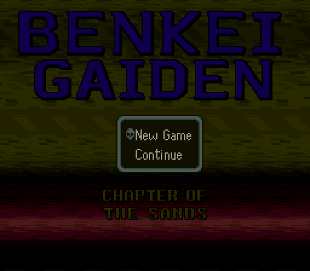
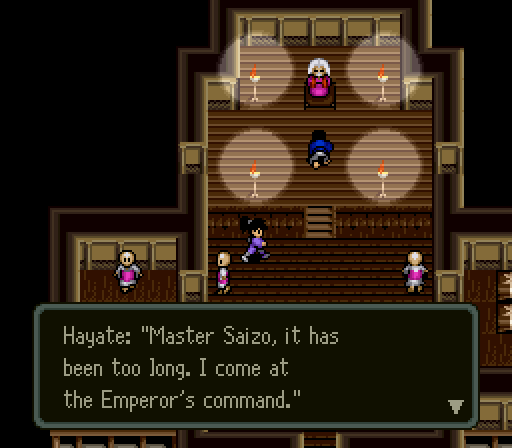
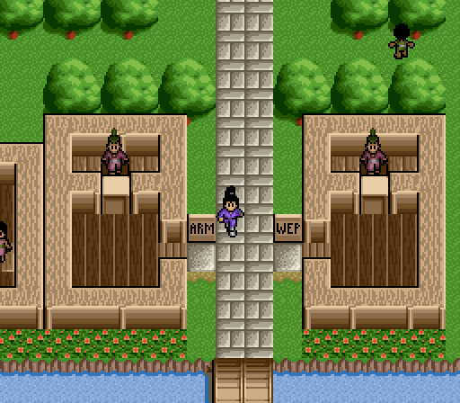
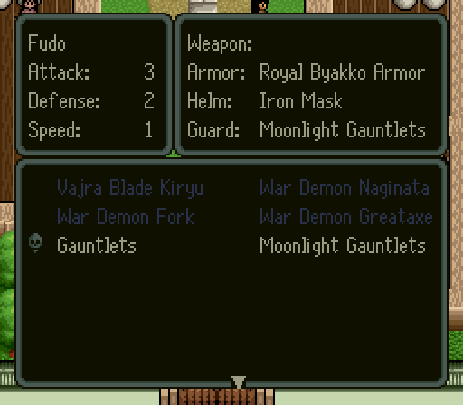
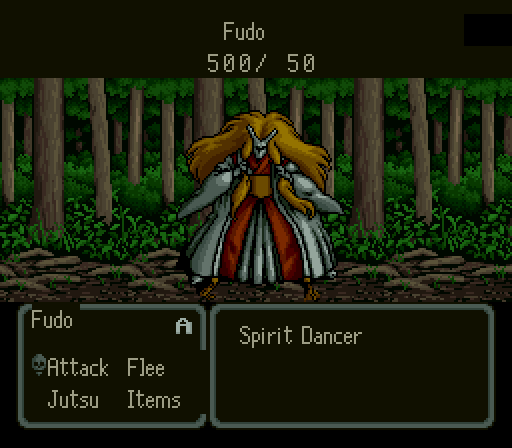
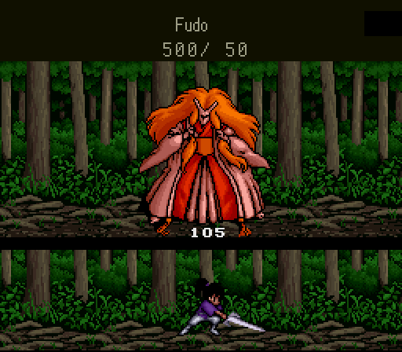

# Benkei Gaiden: Suna no Shou — English Translation

Unofficial archival and historical English fan translation of **Benkei Gaiden: Suna no Shou** (*弁慶外伝 沙の章*, Super Famicom / SNES, Sunsoft, 1992).

> **Players:** Download `benkei-gaiden-suna-no-shou-en.zip` from [Releases](https://github.com/second-save/benkei-gaiden-suna-no-shou-en/releases) and apply `benkei-gaiden-suna-no-shou-en.bps` to your own clean unheadered Japanese dump of *Benkei Gaiden: Suna no Shou*. No ROMs or copyrighted game data are included.

<p align="center">
  
</p>

## Screenshots

<p>
  
  
  
  
  
  
</p>

## Translation Status

| Part | Status | Notes |
|---|---|---|
| Dialogue & story (Act 1 Japan & Act 2 China/Silk Road) | 100% translated | All `3,197` script and table entries translated & reviewed |
| Menus, items, equipment, jutsu, ougi, enemies, locations, system UI | 100% translated | Custom 8px variable-width font (VWF) + 2 MiB LoROM expansion (`$30–$3F`) |
| Title screen, subtitle, shop plaques, battle damage digits & mode badges | 100% translated | `BENKEI GAIDEN` / `CHAPTER OF THE SANDS`, wood & stone shop signs, Arabic `0–9`, `[A]`/`[T]` badges |
| Ending staff credits roll & prologues | 100% translated | Dynamic multi-line crawls & full ending credits in English |
| Name entry & default party names | Default names translated | Defaults set to `Fudo`, `Mikage`, `Tokoyo`, `Byakuren`, `Meisa`; custom kana entry grid retained from the Japanese release |

Known issues: none known.

## Required Japanese Base ROM

Verify your dump before patching:

- **Filename:** `Benkei Gaiden - Suna no Shou (Japan).sfc` (No-Intro unheadered LoROM)
- **Size:** `1,572,864` bytes (`0x180000`)
- **CRC32:** `2743017d`
- **SHA-1:** `05a71b38a66f285564ec8447ff4877db74387860`

If your ROM has a 512-byte copier header (`1,573,376` bytes), remove the header first before applying the `.bps` patch.

## How to Patch & Play

Download `benkei-gaiden-suna-no-shou-en.zip` (or `.bps`) from [Releases](https://github.com/second-save/benkei-gaiden-suna-no-shou-en/releases), then apply `benkei-gaiden-suna-no-shou-en.bps` to the clean Japanese `.sfc` file using any standard BPS patcher:

- **GUI / Web:** [Flips](https://github.com/Alcaro/Flips) or [RomPatcher.js](https://www.marcrobledo.com/RomPatcher.js/)
- **Command line (from this repo):**
  ```sh
  python3 -X utf8 tools/bps.py apply "rom/Benkei Gaiden - Suna no Shou (Japan).sfc" benkei-gaiden-suna-no-shou-en.bps benkei-suna-en.sfc
  ```

| File | Size | CRC32 | SHA-1 |
|---|---:|---|---|
| `benkei-gaiden-suna-no-shou-en.bps` | `247,841` B | `2144df1c` | `4d160e08287ef6719de726c7fd7f5a588cd77623` |
| Patched `.sfc` (SNES checksum `0x5A12`) | `2,097,152` B | `e2a56646` | `aae6bed46e33a8f024273e37b01d90ebeb2932fa` |

> **Emulator & Save Notes:** Tested in **MesenCE 2.2.1** across cold-boot startup, title/graphics, menus, shops, combat, both acts, and the ending credits (not yet tested on real Super Famicom hardware). Always start from a **cold boot**; savestates from the unpatched Japanese ROM are incompatible.

### Controls & Helpful Tips

- **Battle Mode Toggle (`X`):** Pressing `X` on the main battle command menu switches between **Active (`A`)** combat (floating damage numbers over enemies) and **Text (`T`)** combat (play-by-play text log).
- **Equipment Descriptions (`X` twice):** On the Equipment screen, pressing `X` once marks a slot for swap; pressing `X` a second time on an item opens its description popup.
- **Name Entry Sound Test:** Entering the built-in Japanese Easter egg password on the custom kana grid opens the Sound Test (`Sound Test` track titles are in English).

## What's Here (Source Repository)

| Path | What it is |
|---|---|
| `build.py` | Master ROM builder (`identity`, `marker`, `translate` modes) |
| `asm/` | Asar 65816 VWF, bank redirect, UI layout, and graphics integration patches |
| `script/` | Extracted Japanese & translated English text regions (`17` files, `3,197` entries) |
| `tbl/` | Character tables (`en.tbl`, `jp_main.tbl`, `jp_credits.tbl`) |
| `tools/` | Pure-Python stdlib tooling: extract, lint, font/graphics generators, BPS patcher, release packager |
| `tests/` | `unittest` suite covering ROM integrity, text codec/lint, compression, identity build, and graphics |
| `docs/` | Reverse-engineering notes (`docs/re/`), design rulings (`docs/decisions.md`), status & QA logs |
| `glossary.md` | Binding names, historical spellings, and style rules |

## Build From Source

Requires Python 3.12+ (pure stdlib; no third-party pip packages required) and your own verified Japanese dump at `rom/Benkei Gaiden - Suna no Shou (Japan).sfc`:

```sh
python3 -X utf8 tools/check.py                         # verify base ROM hash, script lint, and unit tests
python3 -X utf8 build.py --mode identity                # verify byte-identical JP reconstruction
python3 -X utf8 build.py --mode translate               # build -> build/benkei_suna_en.sfc
python3 -X utf8 tools/release.py                        # build, fix checksum, create & verify .bps and release .zip
```

## Credits & Licence

- **Archival Translation & Engineering:** `second-save`
- **Original Game:** *Benkei Gaiden: Suna no Shou* © 1992 Sunsoft. This project is an unofficial, non-commercial fan translation for archival and historical preservation and is not affiliated with Sunsoft.
- **Licence:** Build tools and original English translation text are released under the MIT Licence. Original Japanese script data in `script/` belongs to Sunsoft and is included solely to verify extraction and translation accuracy. Do not distribute copyrighted ROMs.
